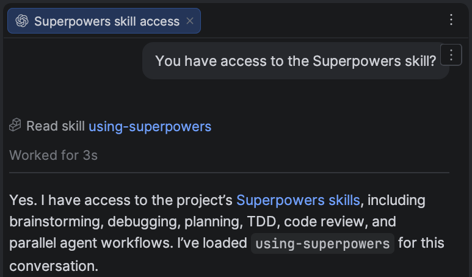

# Advanced SDD...with a Surprise

This repo contains material and code for
the [workshop at AI Dev NYC 2026](https://ai-dev.deeplearning.ai/agenda/advanced-spec-driven-development).

## What in this repo
- `main` branch -- workshop starting point
- `example` branch --  an example of a project that will be created during the workshop
- `workshop` branch -- a project created during the workshop will be published here

## Setup
During the workshop, we'll use the following tools, which you'll also need to set up / get ready to use if you want to try this yourself.
- PyCharm
- Codex integration
- Junie Lite integration (optional)
- LM Studio
- Pi coding agent + IDE integration

To read more about setup process follow [this](./setup.md) guide.

### Pre-flight checklist
- #### ☑️ Current repo is opened in PyCharm  
  
- #### ☑️ Codex in Air reports you Superpowers skill is accessible  
  
- #### ☑️ Junie Lite in Air reports you Superpowers skill is accessible (optional)  
  
- #### ☑️ LM Studio allow you ask Mellum model in the chat  
  
- #### ☑️ Pi in Air reports you Superpowers skill is accessible  
  

## Workshop flow
The demo starts with Phase 1 implemented. Each later phase uses the same four
prompts: design, plan, implement, finish. Review the saved design and plan
before approving them.

### Phase 2 (Codex + Superpowers)
```
Use Superpowers to brainstorm Phase 2 in specs/roadmap.md
```
```
The Phase 2 design looks good. Please proceed with implementation planning.
```
```
The plan looks good. Proceed with native execution.
```
```
Use Superpowers to finish the development branch, then mark Phase 2 in the roadmap as done.
```

### Phase 3 (Junie Lite + Superpowers)
```
Use Superpowers to brainstorm Phase 3 in specs/roadmap.md
```
```
The Phase 3 design looks good. Please proceed with implementation planning.
```
```
The plan looks good. Proceed with native execution.
```
```
Use Superpowers to finish the development branch, then mark Phase 3 in the roadmap as done.
```

### Phase 4 (Pi + Mellum + Superpowers)
```
Use Superpowers to brainstorm Phase 4 in specs/roadmap.md and save the design under docs/superpowers/specs/.
```
Mellum will ask whether to skip its questions. Answer with the decisions:
```
Skip the questions; this is a small change to the existing FastAPI and Jinja app. Direct Resolve and Reopen buttons, no confirmation. Every Complaint gets a unique increasing integer id when constructed, never reused, status starting as open. Both actions redirect 303 to /complaints; unknown id returns 404; board order never changes. Save the design and present it for approval.
```
```
The Phase 4 design looks good. Use Superpowers to write a test-first plan under docs/superpowers/plans/: three tasks, each with its tests and the pytest commands to run.
```
```
The plan looks good. Execute it inline with native tools, one task at a time: add the task's tests, see them fail, make them pass, then run the full suite and report.
```
```
Use Superpowers to finish the development branch, then mark Phase 4 in the roadmap as done.
```
If Mellum stops after one task, continue with `Task 1 is done. Now do Task 2 the same way.`

## Links
- [Slides](https://docs.google.com/presentation/d/e/2PACX-1vSxY7nTT7oZjhovtbsiWKnhvTxcHDCvtyddrrFwDqpvDAto1MxBFTkWPCpP57eqIs_BMHgtA-exAkpK/pub?start=false&loop=false&delayms=3000)
- [Event page](https://ai-dev.deeplearning.ai/agenda/advanced-spec-driven-development)
- [DLAI Discord community](https://discord.gg/SYsha83PS)
- Leave feedback to the next course (coming soon)
