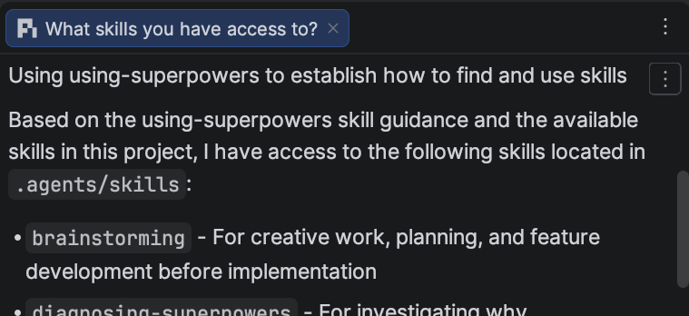

# Advanced SDD...with a Surprise

This repo contains material and code for
the [workshop at AI Dev NYC 2026](https://ai-dev.deeplearning.ai/agenda/advanced-spec-driven-development).

## What in this repo
- `main` branch -- workshop starting point
- `example` branch --  an example of a project that will be created during the workshop
- `workshop` branch -- a project created during the workshop will be published here

## Setup
During the workshop, we'll use the following tools, which you'll also need to set up / get ready to use if you want to try this yourself.
- PyCharm
- Codex integration
- Junie Lite integration (optional)
- LM Studio
- Pi coding agent + IDE integration

To read more about setup process follow [this](./setup.md) guide.

### Pre-flight checklist
- #### ☑️ Current repo is opened in PyCharm  
  
- #### ☑️ Codex in Air reports you Superpowers skill is accessible  
  
- #### ☑️ Junie Lite in Air reports you Superpowers skill is accessible (optional)  
  
- #### ☑️ LM Studio allow you ask Mellum model in the chat  
  
- #### ☑️ Pi in Air reports you Superpowers skill is accessible  
  

## Workshop flow
The demo starts with Phase 1 implemented. Each later phase uses the same four
prompts: design, plan, implement, finish. Review the saved design and plan
before approving them.

### Phase 2 (Codex + Superpowers)
```
Use Superpowers to brainstorm Phase 2 in specs/roadmap.md
```
```
The Phase 2 design looks good. Please proceed with implementation planning.
```
```
The plan looks good. Proceed with native execution.
```
```
Use Superpowers to finish the development branch, then mark Phase 2 in the roadmap as done.
```

### Phase 3 (Junie Lite + Superpowers)
```
Use Superpowers to brainstorm Phase 3 in specs/roadmap.md
```
```
The Phase 3 design looks good. Please proceed with implementation planning.
```
```
The plan looks good. Proceed with native execution.
```
```
Use Superpowers to finish the development branch, then mark Phase 3 in the roadmap as done.
```

### Phase 4 (Pi + Mellum + Superpowers)

Start a fresh Pi session in Air, trust the project settings if prompted, and
select Mellum through LM Studio. Set Pi’s thinking level to High and use the
[60K context setting](setup.md#lm-studio).

```
/skill:brainstorming Brainstorm Phase 4 in specs/roadmap.md and save the design under docs/superpowers/specs/. Limit file changes to the design document.
```

If Pi asks brainstorming questions, reply with this.

```
Skip the questions; the Phase 4 acceptance in the roadmap has the decisions. Save the design and present it for approval. Do not change code yet.
```

After approving the design, send the planning prompt.

```
/skill:writing-plans The Phase 4 design looks good. Proceed with planning in at most three numbered tasks. Use the attached FastAPI guidance to write runnable tests in the task that owns each behavior.
```

```
/skill:executing-plans The plan looks good. Proceed with native execution.
```

The approval prompt names `executing-plans`, so Pi runs the plan with that
skill's task scripts. If Pi skips the planning skill, send the planning prompt
again after `/skill:writing-plans`. If it sends an empty reply, or a reply that is
only a tool call printed as text (`{"name": "read", ...}`), send `Continue.`
If planning stops right after Pi saves its plan, review the plan and send the
approval prompt.

Pi stops after its final review and report. Verify the result, then send the
finish prompt. The workshop extension runs the test suite with the
[exact command in AGENTS.md](AGENTS.md#working-in-this-repo)
and marks Phase 4 done when it passes. If it fails, fix the reported failure and
send the same finish prompt again.

```
Use Superpowers to finish Phase 4. Keep the current branch as-is and mark Phase 4 done in specs/roadmap.md.
```

For a rehearsal, aim for 15 minutes and record any extra steering. After
finishing, check that the implementation commits are still present and confirm
Phase 4 is marked done.

## Links
- [Slides](https://docs.google.com/presentation/d/e/2PACX-1vSxY7nTT7oZjhovtbsiWKnhvTxcHDCvtyddrrFwDqpvDAto1MxBFTkWPCpP57eqIs_BMHgtA-exAkpK/pub?start=false&loop=false&delayms=3000)
- [Event page](https://ai-dev.deeplearning.ai/agenda/advanced-spec-driven-development)
- [DLAI Discord community](https://discord.gg/SYsha83PS)
- Leave feedback to the next course (coming soon)
