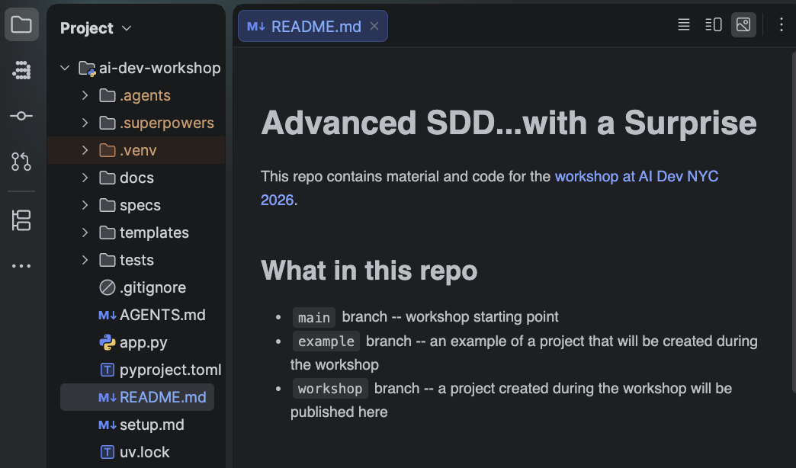
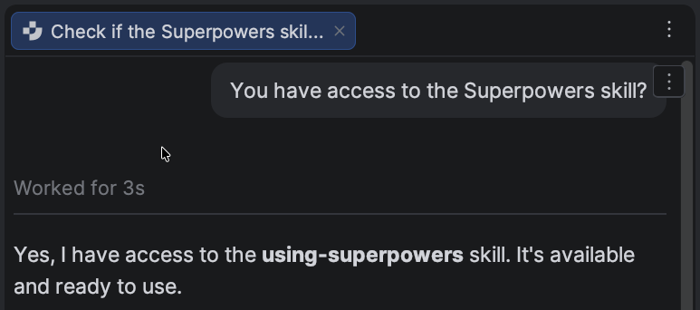
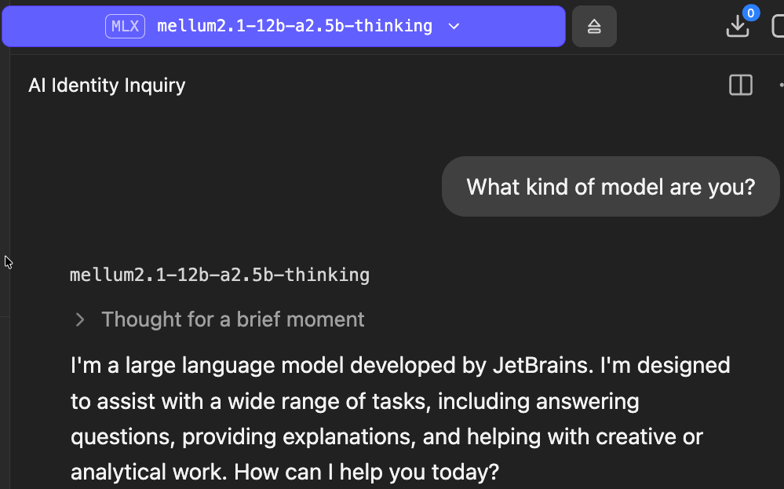

# Advanced SDD...with a Surprise

This repo contains material and code for
the [workshop at AI Dev NYC 2026](https://ai-dev.deeplearning.ai/agenda/advanced-spec-driven-development).

## Where to start

- `dev` is the default branch and starts the full workshop with Phase 1 implemented.
- `phase-4-run` is the Phase 4 rehearsal branch, with Phases 1–3 implemented.

## Setup
Set up these tools before the workshop.

- PyCharm
- uv
- Codex integration
- Junie Lite integration
- LM Studio
- Pi coding agent + IDE integration

Follow the [setup guide](setup.md).

### Pre-flight checklist
- #### ☑️ Current repo is opened in PyCharm  
  
- #### ☑️ Codex in Air reports you Superpowers skill is accessible  
  
- #### ☑️ Junie Lite in Air reports that Superpowers is accessible
  
- #### ☑️ LM Studio allow you ask Mellum model in the chat  
  
- #### ☑️ Pi in Air has loaded the project's Superpowers package
  

## Workshop flow
For each phase, draft a design, write a plan, implement it, and finish. Review
the saved design and plan before approving them.

### Phase 2 (Codex + Superpowers)
```
Use Superpowers to brainstorm Phase 2 in specs/roadmap.md
```
```
The Phase 2 design looks good. Please proceed with implementation planning.
```
```
The plan looks good. Proceed with native execution.
```
```
Use Superpowers to finish the development branch, then mark Phase 2 in the roadmap as done.
```

### Phase 3 (Junie Lite + Superpowers)

Use Junie Lite with Plan mode off for brainstorming and planning.

```
Use Superpowers to brainstorm Phase 3 in specs/roadmap.md
```
```
The Phase 3 design looks good. Please proceed with implementation planning.
```
```
The plan looks good. Proceed with native execution.
```
```
Use Superpowers to finish the development branch, then mark Phase 3 in the roadmap as done.
```

### Phase 4 (Pi + Mellum + Superpowers)

Start a fresh Pi session in Air, trust the project settings if prompted, and
select Mellum through LM Studio. Set Pi’s thinking level to High and use the
[60K context setting](setup.md#lm-studio).

```
/skill:brainstorming Read specs/roadmap.md as input to brainstorm the Phase 4 design. Write only the design document under docs/superpowers/specs/ and stop for approval.
```

If Pi asks brainstorming questions, reply with this.

```
Skip the questions; the Phase 4 acceptance in the roadmap has the decisions. Save the design and present it for approval. Do not change code yet.
```

After approving the design, send the planning prompt.

```
/skill:writing-plans The Phase 4 design looks good. Proceed with planning, and write its tests with the attached FastAPI guidance.
```

Skim the saved plan before approving it, especially for a test in a route task
that checks page text the template task has not added yet. If the plan needs a
change, name one change in this repair prompt.

```
In the saved Phase 4 plan, <one concrete change>. Save it and stop for approval.
```

When the plan is ready, approve it to start native execution.

```
/skill:executing-plans The plan looks good. Proceed with native execution.
```

If Pi sends an empty reply or prints a tool call as text (`{"name": "read", ...}`),
send `Continue.`

After Pi reports its final review, verify the result and send the finish prompt.
The workshop extension runs the test suite with the
[exact command in AGENTS.md](AGENTS.md#working-in-this-repo)
and marks Phase 4 done when it passes. If it fails, fix the reported failure and
send the same finish prompt again.

```
Use Superpowers to finish Phase 4. Keep the current branch as-is and mark Phase 4 done in specs/roadmap.md.
```

For a rehearsal, aim for 15 minutes and record any extra steering. After
finishing, check that the implementation commits are still present and confirm
Phase 4 is marked done.

## Links
- [Slides](https://docs.google.com/presentation/d/e/2PACX-1vSxY7nTT7oZjhovtbsiWKnhvTxcHDCvtyddrrFwDqpvDAto1MxBFTkWPCpP57eqIs_BMHgtA-exAkpK/pub?start=false&loop=false&delayms=3000)
- [Event page](https://ai-dev.deeplearning.ai/agenda/advanced-spec-driven-development)
- [DLAI Discord community](https://discord.gg/SYsha83PS)
- Leave feedback to the next course (coming soon)
